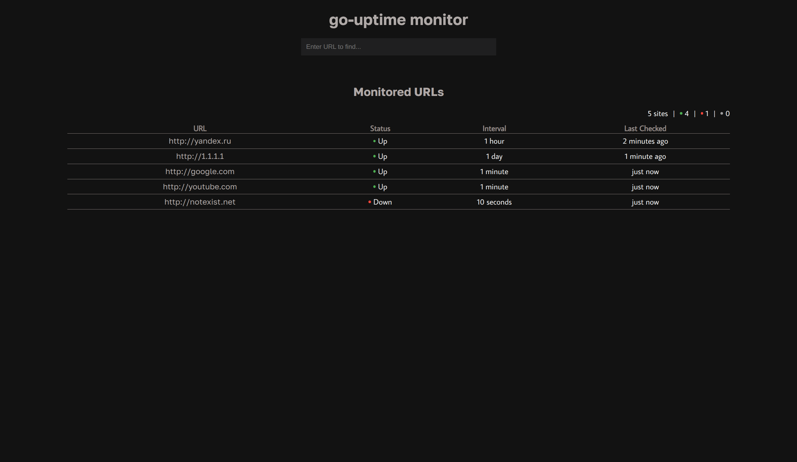
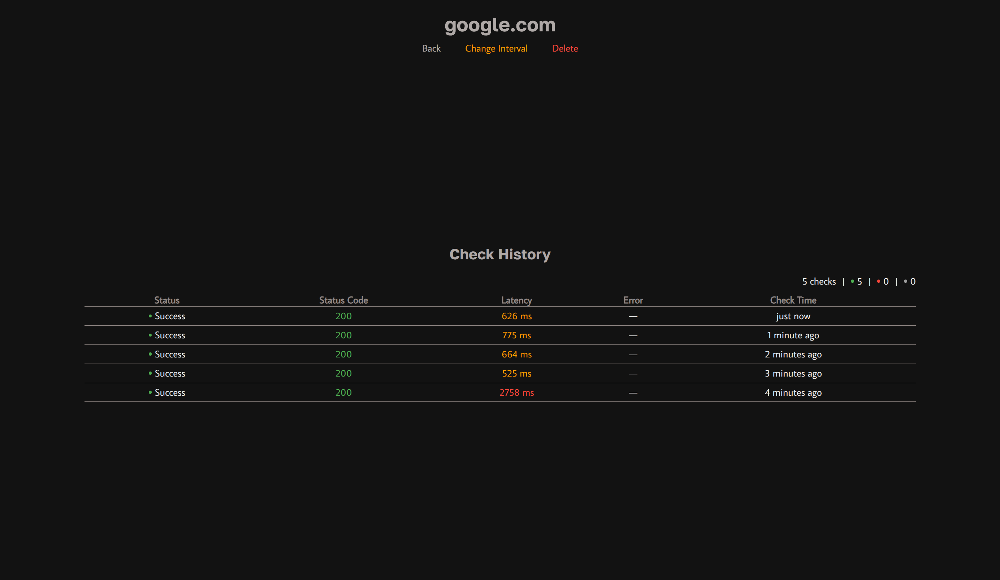

# go-uptime


A CLI tool with a web panel for monitoring resource availability. Supports HTTP and HTTPS protocols, IP addresses and specific ports.

## Features

- Tracking domains, IP addresses, ports
- Support for protocol separation (HTTP/HTTPS)
- Command line control
- Control via web panel
- Live View

## Requirments

go-duplicate requires Docker Compose to run. (See the following [instructions](https://docs.docker.com/compose/install/) to install it)

## Installation and usage

In the directory where you want the program folder to be located, do the following:

```
git clone https://github.com/xueaaaa/go-uptime
cd go-uptime
cp config_example.yml config.yml
```

**The default configuration will be used! Read the [Configuration change ](#configuration-change) if you want to change it.**

To run the application use the following (it will execute the ```serve``` command):

```
docker compose up -d --build
```

To execute other commands, use ```docker compose exec app ./go-uptime <command>```, for example:

```
docker compose exec app ./go-uptime sites add https://example.com
docker compose exec app ./go-uptime sites add https://example.org --interval 30s
docker compose exec app ./go-uptime sites
docker compose exec app ./go-uptime checks
```

## Configuration change

The program directory contains ```config_example.yml```, which has the following form:

```yml
ssl_default: false
server_address: 0.0.0.0:8080
tick_interval: 10s
workers: 50
timeout_after: 10s

database:
  user: root
  password: root
  host: db
  port: 5432
  db: go-uptime
  min_conns: 5
  max_conns: 25
```

Description of all available configuration fields:

| Property           | Default value | Required? | Description                                                                                                                            |
|--------------------|---------------|-----------|----------------------------------------------------------------------------------------------------------------------------------------|
| ssl_default        | false         | no        | Determines which protocol will be used by default when adding addresses without specifying a protocol (HTTPS for true, HTTP for false) |
| server_address     | 0.0.0.0:8080  | no        | The address where the web panel will run (inside the docker container)                                                                 |
| tick_interval      | 10s           | no        | The frequency with which the database will be queried for sites requiring ping (e. g. 10s, 1m15s, 10h etc.)                            |
| workers            | 50            | no        | The number of workers polling sites (it is not recommended to change this value)                                                       |
| timeout_after      | 10s           | no        | The time after sending a request, after which the site will be considered unavailable ((e. g. 10s, 1m15s, 10h etc.)                    |
| database.user      | root          | yes       | Database user                                                                                                                          |
| database.password  | root          | yes       | Database user password                                                                                                                 |
| database.host      | db            | yes       | The host where the database is located                                                                                                 |
| database.port      | 5432          | yes       | Database port on the host                                                                                                              |
| database.db        | go-uptime     | yes       | Application database name                                                                                                              |
| database.min_conns | 5             | no        | It is not recommended to change this value                                                                                             |
| database.max_conns | 25            | no        | It is not recommended to change this value                                                                                             |


The configuration must be contained in a file named ```config.yml```, in the same folder from which the application is launched. The default configuration already contains optimal values; it is not recommended to change it without prior knowledge.

## Commands

Below are the available console commands and their flags:

| Command        | Description                                                                     | Usage example                       | Flags                                                                                                                         |
|----------------|---------------------------------------------------------------------------------|-------------------------------------|-------------------------------------------------------------------------------------------------------------------------------|
| sites          | Displays a summary table of added sites                                         | go-uptime sites                     |                                                                                                                               |
| sites add      | Adds the specified site to the list of sites to be checked                      | go-uptime add example.com           | -interval    --i    how often to check the site's availability (e.g. 30s, 5m)                                                 |
| sites interval | Changes the period for checking the website availability (minimum - 10 seconds) | go-uptime interval example.com 1h2m |                                                                                                                               |
| sites remove   | Removes the specified site from the list of sites to be checked                 | go-uptime remove example.com        |                                                                                                                               |
| checks         | Displays all site checks (limit - 100 latest checks)                            | go-uptime checks                    |                                                                                                                               |
| serve          | Start background sites monitoring                                               | go-uptime serve -silent             | -silent    --s    disables the output of information about completed checks -web    --w    enables web display (default true) |

## Screenshots





## Contributing

Issues and pull requests are welcome. Please run ```go vet ./...``` and ```go test ./...``` before submitting.

## License

See [LICENSE](LICENSE) for details.


